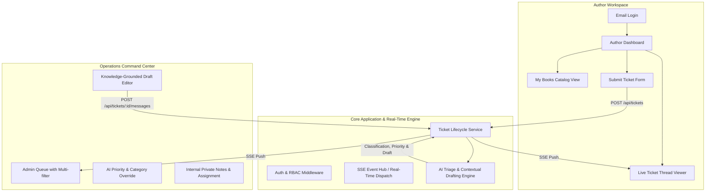

# Product Requirements Document (PRD)

## Document Details
- **Project:** BookLeaf Author Support & Communication Portal
- **Target Role:** Full-Stack Developer Technical Assessment
- **Author:** Full-Stack Engineering Candidate
- **Version:** 1.0.0
- **Status:** Approved for Implementation
- **Reviewers:** BookLeaf Engineering & Operations Team

---

## 1. Executive Summary & Context

BookLeaf Publishing is a high-volume self-publishing platform managing **1,200+ monthly book releases** and a catalog exceeding **22,000+ active titles** across India, the US, and the UK. With thousands of authors onboarded, operational inquiries regarding royalty payouts, physical print defects, ISBN indexing, and marketplace distribution currently swamp support agents.

### Core Problem Statement
Support queries are currently managed across disjointed channels (inbox, spreadsheets, ad-hoc chat), resulting in:
1. **Prolonged SLA Response Times:** 48–96+ hour delays during quarter-end royalty settlement cycles.
2. **Inconsistent Author Communication:** Responses vary in tone, missing contract details, or deflecting legitimate BookLeaf operational bottlenecks.
3. **High Cognitive Load on Operations:** Support executives manually look up sales numbers, royalty logs, and print partners across disconnected records before typing repetitive replies.

### Product Vision
To build a cohesive, dual-sided **Author Support & Communication Portal** (Author Portal + Admin Ops Portal) accelerated by **Human-in-the-Loop AI Assistance**. The system automates inbound classification and urgency scoring upon ticket creation, contextualizes author queries with their live catalog data and BookLeaf operational policy, and drafts high-empathy, accurate responses for one-click admin editing and dispatch.

---

## 2. User Personas & Journey Mapping

### Persona A: The Author (Creator)
* **Archetype:** First-time or multi-title indie author (e.g., Sneha Kulkarni, Vikram Joshi).
* **Motivations:** Transparency on book earnings, quick clarity on publishing delays or Amazon availability, peace of mind that their creative work is treated professionally.
* **Pain Points:** Confusing royalty payout timelines, lack of real-time status on raised complaints, feeling ignored by corporate deflection.
* **Primary Journey:**
  1. Author logs in with email credentials (`priya.sharma@email.com`).
  2. Reviews **My Books** dashboard with transparent breakdown of MRP, units sold, royalty earned, paid, and pending balance.
  3. Raises a query linked directly to a specific book or account-level issue.
  4. Tracks ticket lifecycle in real-time under **My Tickets** with live admin updates without manual page refreshes.

### Persona B: The Operations / Support Specialist (Admin)
* **Archetype:** BookLeaf Ops Executive (handling 80–120 tickets/day).
* **Motivations:** Rapid triage, instant categorization, avoiding manual copy-pasting of policy clauses, clearing priority backlogs.
* **Pain Points:** Context switching between author records and support tickets; determining whether an author query is an urgent print defect or a basic FAQ.
* **Primary Journey:**
  1. Admin logs into the Operations Console.
  2. Views the unified **Ticket Queue**, prioritized by urgency (Critical/High) and age.
  3. Opens a ticket to inspect author metadata, book status, and the pre-computed AI classification and priority.
  4. Reviews an **AI-drafted response** pre-populated with author-specific book data and BookLeaf Knowledge Base policies.
  5. Refines/edits the draft, adds internal notes if escalation is needed, and dispatches the response to the author.

---

## 3. Product Scope & Functional Requirements

### Module 1: Author Portal
* **FR-A1: Authentication & Access Isolation**
  * Email + Password based session management (JWT / secure http-only session).
  * Strict author isolation: An authenticated author can only query, view, and mutate tickets and books matching their own `author_id`.
* **FR-A2: My Books Catalog & Royalty Breakdown**
  * Displays all titles owned by the author.
  * Fields: Title, ISBN, Genre, Publication Date, Lifecycle Status, MRP, Author Royalty/Copy, Total Copies Sold, Total Royalty Earned, Royalty Paid, and Royalty Pending.
  * Explicit empty states and handling for books in production (e.g., `Midnight in Mysore` - In Production / Cover Design) where royalty figures are `N/A`.
* **FR-A3: Ticket Submission Form**
  * Contextual book selector: Dynamic dropdown populated with author's active books, plus a dedicated option for `"General / Account Level"`.
  * Subject line (required, max 120 chars).
  * Description (required, rich multi-line textarea).
  * Attachment upload UI placeholder (file input UI with format validation: `.pdf`, `.png`, `.jpg` up to 10MB; actual upload gracefully simulated/handled).
* **FR-A4: Real-Time Ticket Tracking & Thread**
  * Ticket overview list displaying current status: `Open`, `In Progress`, `Resolved`, `Closed`.
  * Detail conversation thread displaying author's original query, timestamps, and BookLeaf admin replies.
  * Live updates via Server-Sent Events (SSE): Admin replies and status transitions reflect in the author view immediately without page reload.

---

### Module 2: Admin Operations Portal
* **FR-B1: Triage Queue & Multi-dimensional Filtering**
  * Paginated/virtualized list of all submitted tickets across all authors.
  * Filter criteria: Status (`Open`, `In Progress`, `Resolved`, `Closed`), Category, Priority (`Critical`, `High`, `Medium`, `Low`), and Date range.
  * Visual callouts for overdue tickets (>48h) and critical priority tickets (e.g., unpaid royalties > threshold, distributor ISBN mismatches).
* **FR-B2: AI Auto-Classification & Triage Review**
  * Upon ticket submission, the AI classifies the ticket into one of 6 exact taxonomy buckets:
    1. `Royalty & Payments`
    2. `ISBN & Metadata Issues`
    3. `Printing & Quality`
    4. `Distribution & Availability`
    5. `Book Status & Production Updates`
    6. `General Inquiry`
  * AI assigns an initial Priority: `Critical`, `High`, `Medium`, or `Low`.
  * **Human-in-the-Loop Override:** Ops agent can alter category and priority via inline controls if the AI misclassifies.
* **FR-B3: Knowledge-Grounded AI Draft Generation**
  * Contextual draft generator incorporates:
    1. Author query text and subject.
    2. Referenced book metadata (status, print partner, copies sold, pending royalty, last payout date).
    3. Targeted BookLeaf Knowledge Base guidelines (80/20 royalty split, ₹1,000 threshold, 45-day quarterly payout, 5–7 business days reprint SLA, 24–48h distribution stock sync SLA).
  * Admin review interface: Rich editable draft container allowing the agent to tweak wording, verify numbers, and click "Send Response".
* **FR-B4: Ticket Assignment & Internal Notes**
  * Admin can self-assign or re-assign tickets (`assigned_to: "Admin Name"`).
  * Private internal notes thread: Visible only to admins, strictly hidden from author responses (used for ops handover, e.g., "Triggered Repro India re-run on job #8812").

---

### Module 3: AI Integration & Policy Governance
* **FR-C1: Strict BookLeaf Tone Alignment**
  * Empathy-first, ownership-driven, partnership framing ("Authors are our partners, not customers to be managed").
  * Zero corporate deflection; direct ownership of errors with concrete 48-hour resolution commitments.
  * Concrete numbers (e.g. citing ₹1,000 payout threshold and next quarterly calculation cycle).
* **FR-C2: Graceful Degradation & Resilience**
  * If the LLM provider experiences 429 (rate limit), 503 (service outage), or network timeout:
    - Ticket submission **must never fail**.
    - System falls back to a deterministic regex/heuristic classifier (`Category: General Inquiry`, `Priority: Medium`).
    - Admin UI alerts the agent: *"AI drafting unavailable — manual reply mode active"*.
* **FR-C3: Token Cost Awareness**
  * Prevents blindly passing the entire 3,000-word knowledge base on every ticket.
  * Implements dynamic context injection: Only the matched policy module (e.g., Royalty Policy or Printing Policy) and the author's relevant book record are supplied to the prompt.

---

## 4. Non-Functional Requirements (NFRs)

| Dimension | Specification | Verification Method |
| :--- | :--- | :--- |
| **Response Latency** | REST API endpoints p95 < 120ms (excluding external LLM calls). | Server request timing logs. |
| **Real-time SLA** | New message push delivered to author client in < 500ms via SSE. | SSE connection message timestamp diff. |
| **AI Triage Latency** | Asynchronous / background triage completed within 2.5 seconds of ticket creation. | Job execution logs. |
| **Data Security** | Passwords hashed using bcrypt; JWT tokens signed with secure server secret; RBAC verified on every endpoint. | Route unit tests and penetration boundary checks. |
| **Secrets Protection** | Zero client-side exposure of `LLM_API_KEY` or database credentials; validated via build linter. | Automated git pre-commit checks. |
| **Browser Compatibility** | Modern Evergreen browsers (Chrome, Firefox, Safari, Edge) on desktop and mobile viewports. | Responsive viewport testing. |

---

## 5. Domain Edge Cases & Business Rules Matrix

| Scenario | System Expected Behavior |
| :--- | :--- |
| **Book in Production (No Sales/Royalties)** | Author selects `BK013 (Midnight in Mysore - In Production)`. Form disables royalty-specific queries or warns that the book has not generated sales yet. AI draft references current stage (`Cover Design` or `Typesetting`) with collaborative timeline expectation. |
| **Royalty Below Threshold (< ₹1,000)** | Author has pending royalty of ₹850 (`AUTH009 - Kavita Deshmukh`). AI draft accurately explains the ₹1,000 minimum payout threshold, confirms ₹850 has rolled over to next quarter, and avoids falsely promising immediate payout. |
| **Pending Payout > Threshold (> ₹1,000)** | Author has pending royalty of ₹5,280 (`AUTH002 - Rohit Kapoor`). AI draft verifies last payout date (`2025-09-01`), explains the 45-day post-quarter cycle, and provides a clear 48-hour escalation timeline if payment is overdue. |
| **Physical Defect / Misprint Query** | AI response apologizes without defensiveness, requests clear photos of damaged copies/binding, and commits to a free reprint turnaround of 5–7 business days via print partner. |
| **Distribution / Unavailable on Amazon** | AI response recognizes stock synchronization delay, sets 24–48 hour timeline for catalog re-sync, and notifies operations. |
| **Admin Ticket Stealing / Race Condition** | When an admin takes ownership or updates status, real-time SSE broadcasts ticket state so other active admins see the updated assignment immediately without overwriting. |
| **LLM Provider Outage** | System logs the failure, tags ticket with `ai_status: "failed"`, assigns fallback category/priority, and allows admin to compose replies manually with zero user disruption. |

---

## 6. Success Metrics & Acceptance Criteria

1. **Author Verification:**
   - [x] Author can log in as any of the 10 seeded authors (e.g. `priya.sharma@email.com` / `password123`).
   - [x] Author sees only their own titles, sales counts, and royalty balances.
   - [x] Author can submit a ticket with book association and view it in real-time under "My Tickets".
2. **Operations Verification:**
   - [x] Admin can log in (`admin@bookleafpub.com`), access full ticket queue, and filter by status, priority, and category.
   - [x] Inbound ticket receives automatic AI categorization and priority score within seconds.
   - [x] Admin can click into ticket, review an AI-drafted reply that accurately cites BookLeaf policies and the author's live book data, edit it, and send it.
   - [x] Author receives the admin reply instantly without refreshing the page.
3. **Engineering Integrity:**
   - [x] Fully functioning end-to-end with pre-seeded dataset (`bookleaf_sample_data.json`).
   - [x] Clean architecture, strict RBAC, comprehensive error handling, and production-ready documentation.
