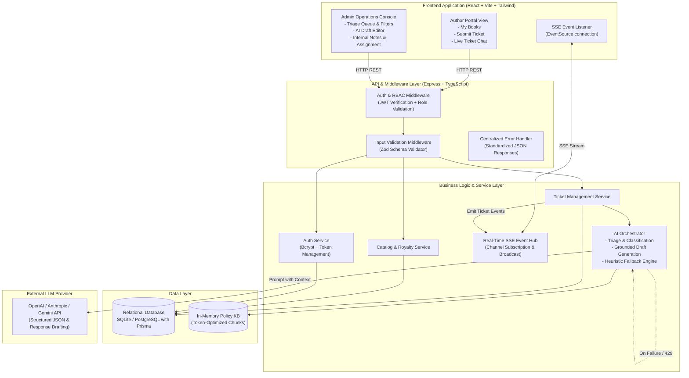
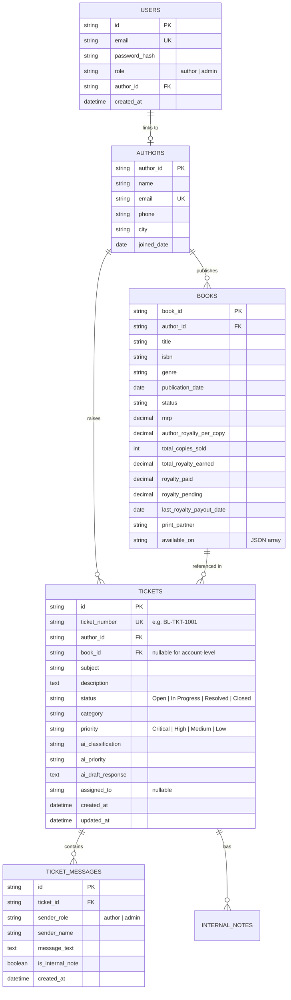
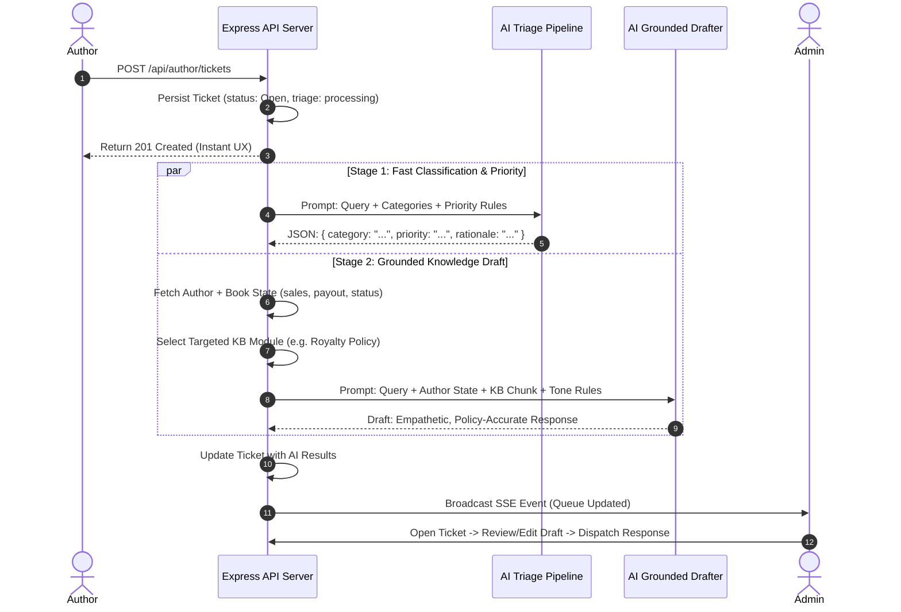

# Technical Requirements & Design Document (TRD)

## Document Details
- **Project:** BookLeaf Author Support & Communication Portal
- **System Architecture:** Full-Stack Decoupled Monorepo (Node.js/Express + React/TypeScript)
- **Author:** Full-Stack Engineering Candidate
- **Version:** 1.0.0
- **Status:** Approved for Implementation

---

## 1. System Architecture Overview

The system is architected as a robust, production-ready web application designed for high developer velocity, zero-config evaluation, and clean separation of concerns.



---

## 2. Technology Stack Selection & Rationale

| Layer | Chosen Technology | Engineering Rationale & Trade-offs |
| :--- | :--- | :--- |
| **Frontend** | **React 18 + Vite + TypeScript + Tailwind CSS** | - **Vite:** Sub-second cold starts and rapid HMR for optimal review ergonomics.<br>- **TypeScript:** Shared data interfaces between client and server prevent schema drift.<br>- **Tailwind CSS:** Clean, maintainable UI without bloated third-party component dependencies. |
| **Backend** | **Node.js + Express + TypeScript** | - **Express:** Industry standard, explicit middleware pipeline for JWT/RBAC, predictable execution.<br>- **Layered Structure:** Strict separation: `routes/` $\rightarrow$ `controllers/` $\rightarrow$ `services/` $\rightarrow$ `repositories/`. Avoids monolith spaghetti. |
| **Database & ORM** | **SQLite (Better-SQLite3 / Prisma ORM) with Postgres Parity** | - **Zero-Setup Evaluation:** Evaluators run `npm run dev` with zero Docker or remote DB connection friction.<br>- **ACID Compliance & Foreign Keys:** Full relational integrity for author-book-ticket relationships with simple migration path to Postgres via Prisma. |
| **Real-Time Protocol** | **Server-Sent Events (SSE)** | - **Why not WebSockets?** Ticket updates are inherently unidirectional (server pushing admin responses and ticket state to author).<br>- **Advantages:** Operates over standard HTTP/2, native browser automatic reconnection (`EventSource`), zero socket handshake overhead, firewall/proxy friendly. |
| **AI Integration** | **OpenAI (`gpt-4o-mini`) / Google Gemini (`gemini-1.5-flash`)** | - **Model Choice Justification:** $0.15/1M input tokens, sub-second latency, native support for JSON schema enforcement, and outstanding empathy/instruction adherence.<br>- **Robust Fallback:** Heuristic keyword classifier prevents any user-facing breakdown during API outages. |

---

## 3. Database Schema Design & Data Modeling



### Relational Constraints & Database Indexes
1. `idx_tickets_author_id`: Fast lookup for author portal query filtering.
2. `idx_tickets_status_priority_created`: Composite index powering admin triage queue sort (`ORDER BY priority DESC, created_at ASC`).
3. `idx_books_author_id`: Immediate catalog lookups on author dashboard load.
4. `idx_ticket_messages_ticket_id_created`: Chronological conversation retrieval.

---

## 4. RESTful API Specification & Contracts

### 4.1 Response Wrapper Specification
All API responses follow a strict envelope contract:
```json
// Success Response
{
  "success": true,
  "data": { ... },
  "meta": { "timestamp": "2026-10-27T00:00:00Z" }
}

// Error Response
{
  "success": false,
  "error": {
    "code": "VALIDATION_ERROR",
    "message": "Subject must be between 5 and 120 characters",
    "details": [ ... ]
  }
}
```

### 4.2 Endpoint Catalog

#### Auth Module
- `POST /api/auth/login`
  - Body: `{ "email": "priya.sharma@email.com", "password": "password123" }`
  - Response: `{ "user": { "id": "...", "email": "...", "role": "author", "author_id": "AUTH001", "name": "Priya Sharma" }, "token": "JWT_STRING" }`
- `GET /api/auth/me`
  - Headers: `Authorization: Bearer <token>`
  - Response: Current user session profile.

#### Author Portal Module
- `GET /api/author/books`
  - Description: Returns books owned by the logged-in author.
  - Role: `author`
- `GET /api/author/tickets`
  - Description: Returns ticket history for the logged-in author.
  - Role: `author`
- `POST /api/author/tickets`
  - Description: Submits a new support ticket. Triggers AI classification, priority scoring, and draft response generation asynchronously.
  - Body:
    ```json
    {
      "book_id": "BK001", // or null for General/Account
      "subject": "Royalty payout query for Q3",
      "description": "I sold 342 copies but haven't received my pending ₹3,570 yet."
    }
    ```
- `GET /api/author/tickets/:id`
  - Description: Retrieves ticket thread with admin responses.
  - **Security Gate:** Strips any messages where `is_internal_note: true`.

#### Admin Operations Module
- `GET /api/admin/tickets`
  - Query Params: `?status=Open&priority=High&category=Royalty&search=Priya`
  - Description: Filtered and prioritized queue for operations agents.
- `GET /api/admin/tickets/:id`
  - Description: Returns full ticket context including author profile, associated book stats, AI classification metadata, generated draft, and internal private notes.
- `PATCH /api/admin/tickets/:id`
  - Description: Updates ticket status, category override, priority override, or assigned agent.
  - Body:
    ```json
    {
      "status": "In Progress",
      "category": "Royalty & Payments",
      "priority": "Critical",
      "assigned_to": "Rohan (Operations)"
    }
    ```
- `POST /api/admin/tickets/:id/messages`
  - Description: Sends a response to the author OR records an internal private note.
  - Body:
    ```json
    {
      "message_text": "Hello Priya, We verified your Q3 royalty...",
      "is_internal_note": false
    }
    ```
  - Side Effect: Dispatches SSE event to author client; updates ticket status to `In Progress` or `Resolved`.
- `POST /api/admin/tickets/:id/ai-regenerate`
  - Description: Allows admin to re-run AI draft generation with custom agent guidance or refreshed parameters.

#### Real-Time SSE Module
- `GET /api/realtime/stream`
  - Headers: `Accept: text/event-stream`, `Authorization: Bearer <token>`
  - Dispatches events: `ticket_created`, `ticket_updated`, `new_message`, `status_changed`.

---

## 5. AI Integration Architecture & Cost Optimization

### 5.1 Two-Stage AI Pipeline



### 5.2 Token Cost Awareness & Context Pruning Strategy
Instead of sending the entire 3,000-word BookLeaf Knowledge Base on every single invocation, the system employs **Targeted Context Injection**:
1. **Dynamic KB Slicing:** The Knowledge Base is partitioned into modular units:
   - `KB_COMPANY_CORE` (~150 tokens)
   - `KB_ROYALTY_POLICY` (~250 tokens)
   - `KB_ISBN_POLICY` (~120 tokens)
   - `KB_PRINTING_QUALITY` (~180 tokens)
   - `KB_DISTRIBUTION` (~150 tokens)
   - `KB_PRODUCTION_STAGES` (~180 tokens)
2. **Context Resolution:**
   - Classification call uses **zero** KB text, strictly using category definitions and priority heuristics (~300 tokens input).
   - Draft generation injects only `KB_COMPANY_CORE` + the classified specific module + the author's target book row (~600 tokens input).
   - **Result:** ~75% reduction in token consumption per ticket compared to a naive full-context dump.

### 5.3 Prompt Engineering & Tone Calibration

#### System Prompt (Admin Draft Assistant)
```text
You are BookLeaf Publishing's Senior Author Support Specialist.
Your communication tone MUST adhere strictly to these principles:
1. EMPATHETIC & PROFESSIONAL: Authors are our creative partners, never customers to be deflected.
2. OWNERSHIP: If something is a BookLeaf delay or error, own it directly without corporate jargon.
3. CONCRETE & SPECIFIC: Cite actual figures (MRP, copies sold, pending payout, last payout date) from the author's data. Reference exact policy rules (80/20 split, ₹1,000 threshold, 45-day post-quarter settlement).
4. CLEAR NEXT STEP: Always conclude with an actionable timeline (e.g. "Our accounts desk will complete verification within 48 hours") and direct next steps.

KNOWLEDGE BASE CONTEXT:
{{SELECTED_KB_CHUNK}}

AUTHOR & BOOK CONTEXT:
Author: {{AUTHOR_NAME}} (Joined: {{JOINED_DATE}})
Book: {{BOOK_TITLE}} (Status: {{BOOK_STATUS}}, Copies Sold: {{COPIES_SOLD}}, Pending Royalty: ₹{{ROYALTY_PENDING}}, Last Payout: {{LAST_PAYOUT_DATE}})

QUERY:
Subject: {{SUBJECT}}
Description: {{DESCRIPTION}}

Draft a warm, precise, and supportive reply ready for admin review:
```

### 5.4 Graceful Degradation & Heuristic Fallback
When external LLM APIs fail (e.g., rate-limit HTTP 429, API downtime HTTP 503, or invalid API key), the system activates a **Local Heuristic Rule Engine**:
- **Classification Rules:**
  - Contains `"royalty"`, `"payout"`, `"money"`, `"earned"` $\rightarrow$ `Royalty & Payments`
  - Contains `"isbn"`, `"metadata"`, `"barcode"` $\rightarrow$ `ISBN & Metadata Issues`
  - Contains `"print"`, `"page"`, `"cover"`, `"damaged"`, `"binding"` $\rightarrow$ `Printing & Quality`
  - Contains `"amazon"`, `"flipkart"`, `"unavailable"`, `"stock"` $\rightarrow$ `Distribution & Availability`
  - Contains `"proof"`, `"typesetting"`, `"stages"` $\rightarrow$ `Book Status & Production Updates`
  - Default: `General Inquiry`
- **Priority Rules:**
  - Mentions of missing payments > 3 months or incorrect ISBN $\rightarrow$ `Critical` / `High`
  - General formatting questions $\rightarrow$ `Low`
- **Draft Fallback:** Generates a clean standard template with author and book placeholders, alerting the admin: *"AI service unavailable. Template loaded for manual editing."*

---

## 6. Security, Authentication & Role-Based Access Control (RBAC)

1. **Password Storage:** Hashed using `bcrypt` (10 rounds salt).
2. **Session Security:** Signed JSON Web Tokens (JWT) with standard expiration and verification middleware.
3. **Row-Level Security (RLS) Enforcement:**
   ```typescript
   // Middleware verifies ticket belongs to requesting author
   if (req.user.role === 'author' && ticket.author_id !== req.user.authorId) {
     return res.status(403).json({
       success: false,
       error: { code: 'FORBIDDEN', message: 'Unauthorized ticket access' }
     });
   }
   ```
4. **Environment Secret Protection:**
   - `LLM_API_KEY`, `JWT_SECRET`, and `DATABASE_URL` are strictly loaded server-side via `process.env`.
   - Never bundled into client builds or returned in API responses.
   - Built-in `vite.config.ts` ensures client bundle includes zero `process.env` backend keys.
